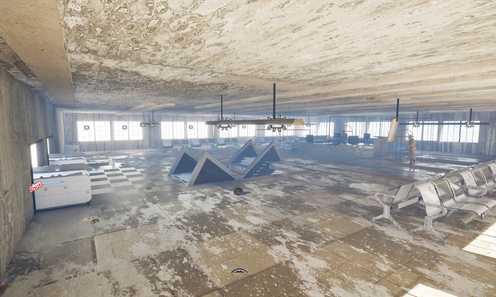
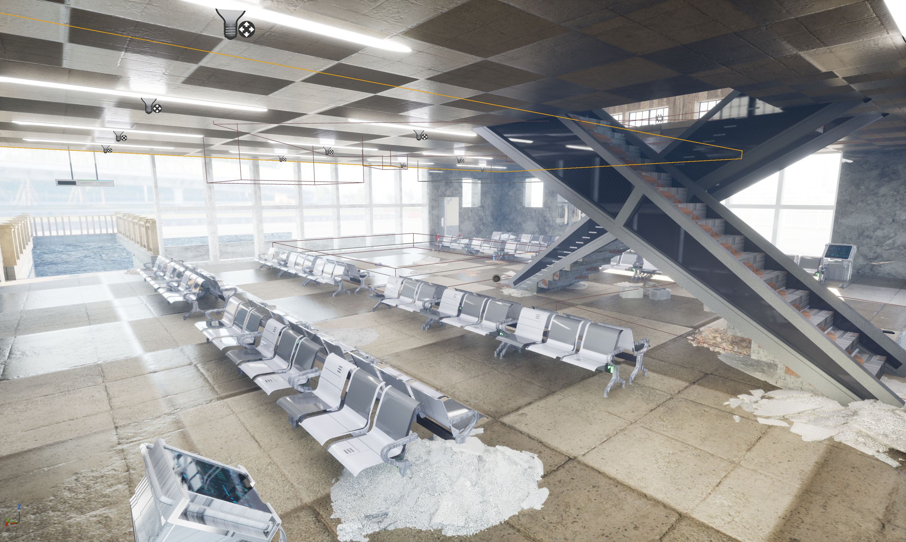
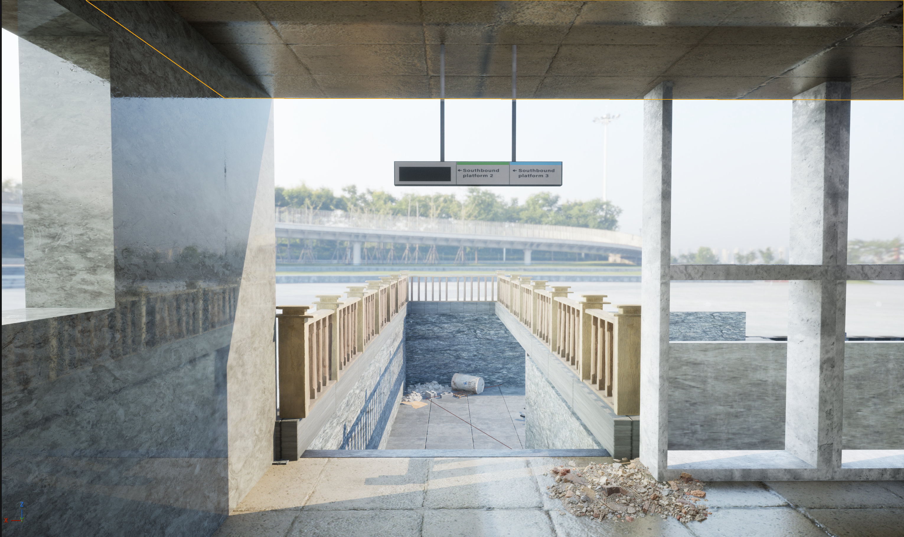
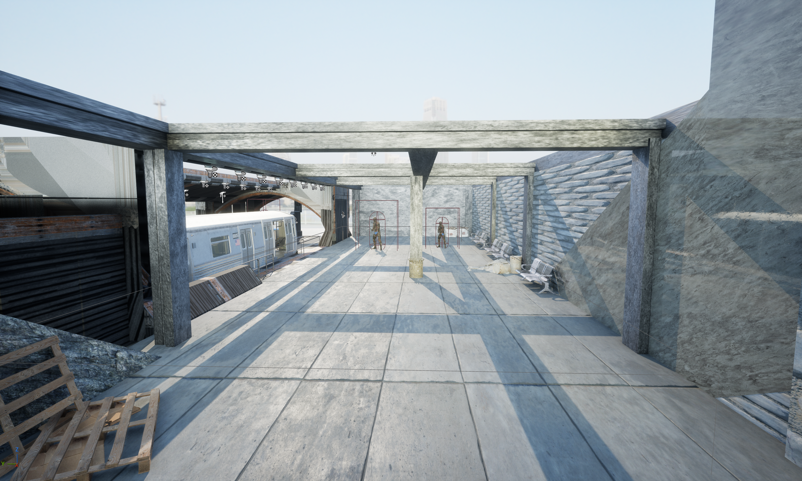
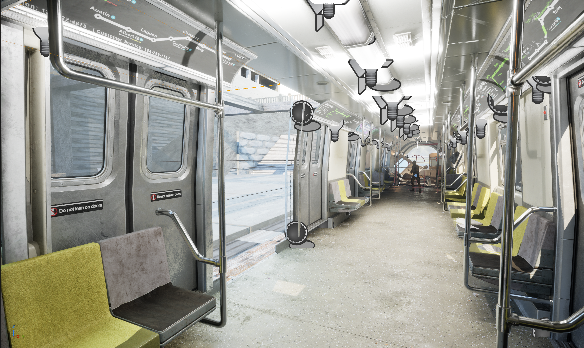
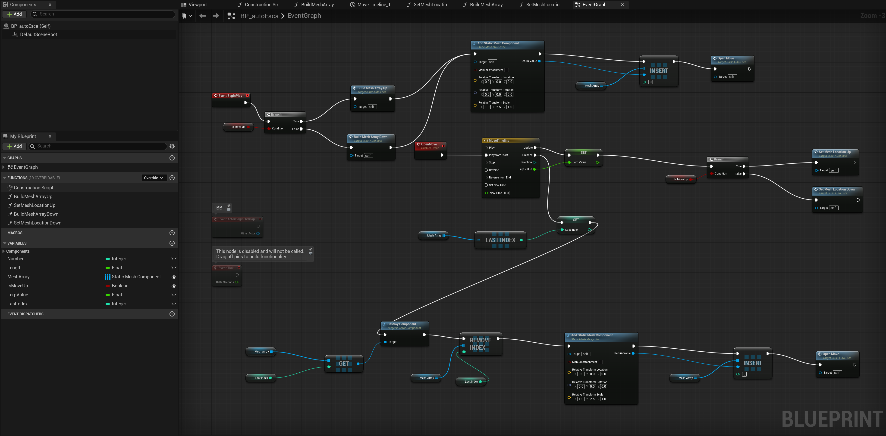
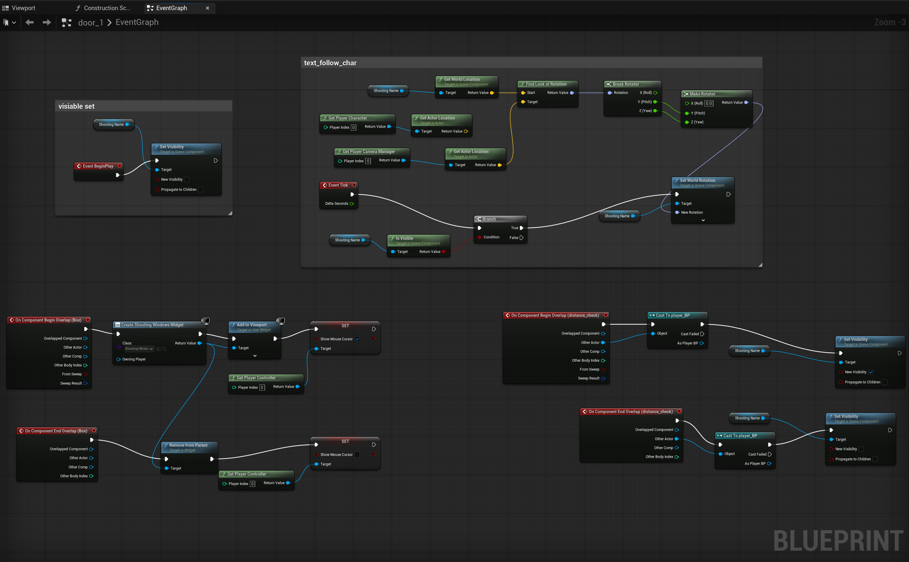
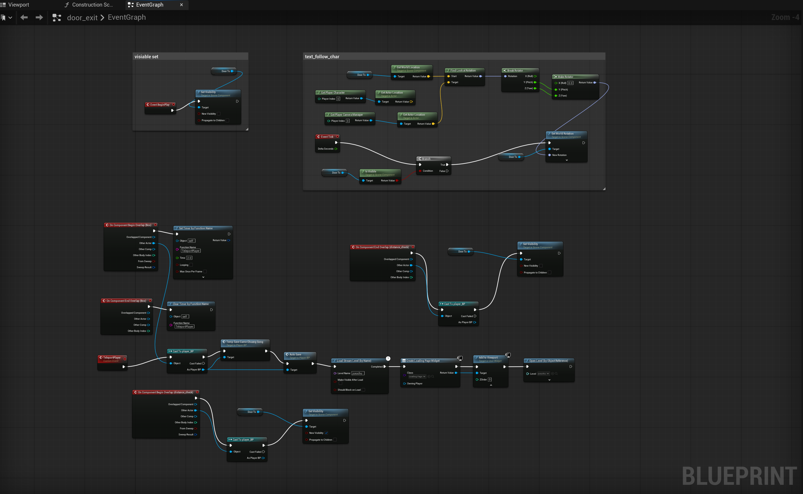
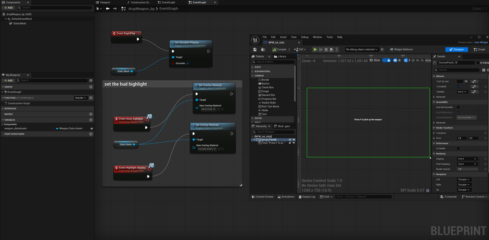

# UE5 Underground Station Level

A playable, multi-floor abandoned underground station built in Unreal Engine 5.6.1. The player starts in the upper waiting hall and works down through the concourse, platform and tunnels to an exit that loads the next level.

**My role:** group project. I built the whole map: layout, lighting, atmosphere and the level Blueprints described below (escalator, door prompts, exit transition, pickup prompts). The player character, enemy AI and weapons came from a teammate.

## Level walkthrough

| Area | What happens there |
|---|---|
| Upper waiting hall | Spawn point; sets the mood and scale of the station |
| Concourse | Debris, benches and broken boards; first optional weapon pickups; view out to the walkway |
| Outdoor walkway | HDRI sky, an open break between the enclosed floors |
| Platform | Main combat space; lighting and barriers steer the player along the platform |
| Tunnel | Narrow, dark corridor past a derailed train to the exit |

The route is signposted with lighting, props and the shape of the space rather than UI arrows.

  
  
  
  

## Blueprints

### Escalator (`BP_autoEsca`)

The escalator builds its steps as an array of static mesh components on `BeginPlay` (one function each for up and down escalators). A Timeline drives a lerp value that moves every step along the slope; when a cycle finishes, the last step is destroyed and removed from the array and a new one is inserted at the front, so the escalator runs continuously.

### Door prompts (`door_1`)

A distance-check box shows a text label when the player comes near and hides it when they leave. While visible, the label turns every tick to face the camera. Stepping into the inner box opens a widget and shows the mouse cursor; leaving removes it.

### Exit and level transition (`door_exit`)

Standing in the exit box starts a 2-second timer (cancelled if the player steps out). When it fires, the game saves the player's state, streams in the next level, shows a loading screen and opens the new level.

### Weapon pickup prompt (`dropWeapon_bp`, `BPW_txt_tishi`)

Dropped weapons simulate physics. Highlight events from the player switch an overlay material on and off, and a hint widget shows "Press F to pick up the weapon".

## Downloads

The UE5 project is too large for GitHub, so this repo holds the screenshots and Blueprint captures only.

- [Playthrough video](https://drive.google.com/file/d/1mUTDzbTSbovZPY6yt5wxLsGlH_FHeAZO/view?usp=sharing)
- [Windows build](https://drive.google.com/drive/folders/1NYgutUPhsYXTx3ksWA8IZWykiwtm7k73?usp=sharing)
- [Full UE5 project](https://drive.google.com/drive/folders/1J7oBBeE6-gXomQ9xo9Kn_41dar-nEcRf?usp=drive_link)
